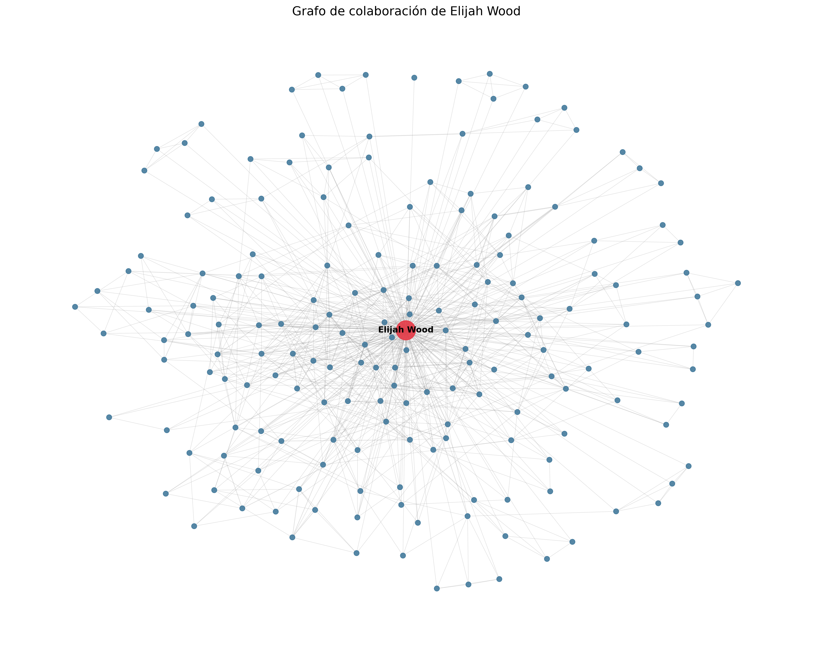
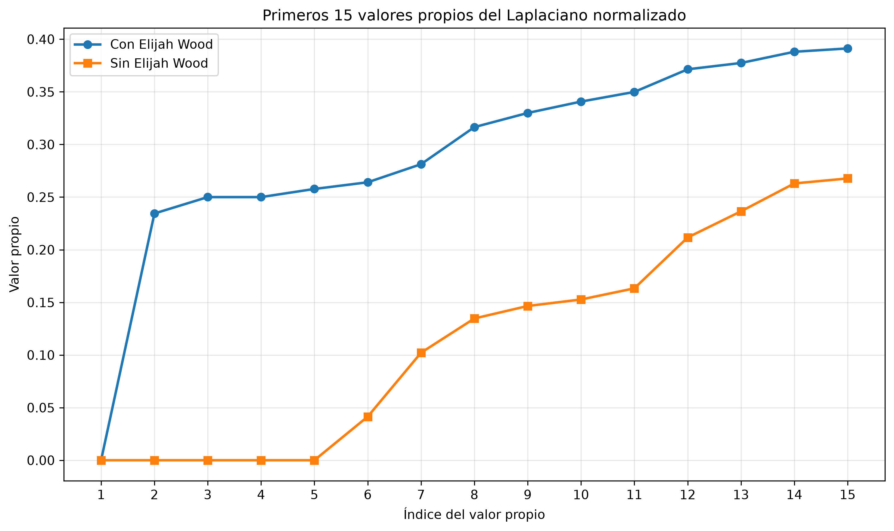

# Análisis de una red de colaboración cinematográfica: Elijah Wood

Proyecto final del curso **Análisis y Ciencia de Datos**.

## Descripción

Este proyecto analiza una red de colaboración cinematográfica centrada en el actor Elijah Wood, utilizando información obtenida de la API de The Movie Database (TMDB).

Se construye un grafo no dirigido y ponderado, donde los nodos representan actores y las aristas representan colaboraciones en películas compartidas. El peso de cada arista corresponde a la cantidad de películas en las que dos actores participaron conjuntamente.

A partir de esta red se estudian su conectividad, estructura espectral y posibles comunidades mediante técnicas de teoría de grafos y clustering espectral.

## Objetivos

- Construir un grafo de colaboraciones cinematográficas a partir de información de TMDB.
- Implementar una clase `Graph` para administrar nodos, aristas y pesos.
- Analizar componentes conexas mediante BFS y valores propios de los Laplacianos.
- Identificar posibles comunidades utilizando clustering espectral.
- Estudiar la estructura de la red mediante el vector de Fiedler.

## Metodología

### 1. Obtención de datos

Se utiliza la API de TMDB para consultar la filmografía de Elijah Wood y los repartos de las películas seleccionadas.

Se consideran películas estrenadas entre el 1 de enero de 1975 y el 31 de diciembre de 2025, excluyendo documentales y apariciones del actor interpretándose a sí mismo según los filtros implementados.

Para construir el conjunto inicial de actores se seleccionan películas en las que Elijah Wood aparece entre los primeros cinco integrantes del reparto. Posteriormente, se consultan los créditos de los actores incorporados para identificar colaboraciones adicionales entre los nodos existentes.

Las respuestas de la API se almacenan en archivos JSON dentro de `cache/`, permitiendo ejecutar el proyecto sin realizar nuevas solicitudes.

### 2. Construcción del grafo

Se implementa una clase `Graph` que permite agregar nodos y aristas, calcular grados, obtener estadísticas y generar una matriz de adyacencia ponderada.

Cada actor se identifica mediante su ID de TMDB. Las conexiones representan películas compartidas entre dos actores y sus pesos se incrementan por cada colaboración registrada.

### 3. Análisis espectral

Se construyen el Laplaciano no normalizado y el Laplaciano normalizado simétrico. Mediante sus valores y vectores propios se estudian las componentes conexas, la conectividad y las brechas espectrales.

Se aplica clustering espectral utilizando vectores propios normalizados y K-Means. Adicionalmente, se utiliza el vector de Fiedler para analizar una posible división de la componente principal después de eliminar a Elijah Wood.

## Resultados principales

| Indicador | Resultado |
|---|---:|
| Actores (nodos) | 179 |
| Conexiones (aristas) | 781 |
| Colaboraciones ponderadas | 866 |
| Grado simple de Elijah Wood | 178 |
| Grado ponderado de Elijah Wood | 188 |
| Componentes conexas con Elijah Wood | 1 |
| Componentes conexas sin Elijah Wood | 5 |
| Segundo valor propio normalizado con Elijah Wood | 0.23442671 |
| Mayor brecha espectral global | k = 1 |
| Comunidades exploratorias | 7 |
| División mediante Fiedler | 11 y 154 actores |

La eliminación de Elijah Wood divide el grafo en cinco componentes de tamaños 165, 4, 4, 4 y 1, lo que evidencia su importancia para conectar determinados grupos de actores.

La mayor brecha espectral global propone una sola comunidad. Para estudiar agrupaciones internas se utiliza de manera exploratoria una brecha secundaria en k = 7, obteniendo comunidades de tamaños 10, 33, 4, 16, 8, 10 y 98 actores.

El vector de Fiedler permite dividir la componente principal de 165 actores en dos grupos, conectados entre sí mediante 11 aristas con peso total de 12.

## Visualizaciones

### Grafo de colaboraciones



### Espectro del Laplaciano normalizado



## Estructura del proyecto

```text
ElijahWood-ProyectoFinal-Analisis/
├── cache/
│   └── Archivos JSON de TMDB
├── figuras/
│   ├── grafo_elijah_wood.png
│   └── espectro_laplaciano.png
├── proyecto_elijah_wood.ipynb
├── pyproject.toml
├── uv.lock
├── .gitignore
└── README.md
```

## Requisitos

- Python 3.11 o superior.
- `uv` para administrar el entorno y las dependencias.
- Jupyter Notebook o Visual Studio Code con soporte para notebooks.

Las dependencias utilizadas incluyen NumPy, Matplotlib, NetworkX, scikit-learn, Requests, python-dotenv, Pandas y Jupyter.

## Instalación y ejecución

**1. Clonar el repositorio**

```bash
git clone https://github.com/USUARIO/ElijahWood-ProyectoFinal-Analisis.git
cd ElijahWood-ProyectoFinal-Analisis
```

Sustituir `USUARIO` por el propietario real del repositorio.

**2. Instalar las dependencias**

```bash
uv sync
```

**3. Abrir Jupyter Notebook**

```bash
uv run jupyter notebook
```

Abrir el archivo `proyecto_elijah_wood.ipynb` y ejecutar todas las celdas en orden.

### Ejecución sin API key

El proyecto puede ejecutarse utilizando los archivos JSON almacenados en `cache/`, sin necesidad de disponer de una clave de TMDB.

La configuración utilizada para trabajar exclusivamente con el caché es:

```python
API_KEY = None
```

Para realizar nuevas consultas a TMDB, puede configurarse un archivo `.env` con la variable `TMDB_API_KEY` y habilitar su lectura desde el notebook.

El archivo `.env` no debe incluirse en el repositorio.

## Conclusiones

El análisis permitió construir una red de colaboraciones cinematográficas y estudiar su estructura mediante métodos de teoría de grafos y álgebra lineal.

Los resultados muestran que Elijah Wood cumple un papel importante en la conectividad global de la red, aunque la mayoría de los actores permanece conectada después de eliminarlo.

El clustering espectral permitió explorar agrupaciones asociadas con películas y colaboraciones específicas, mientras que el vector de Fiedler identificó una separación relativamente diferenciada dentro de la componente principal.

En conjunto, el proyecto demuestra cómo el análisis espectral puede utilizarse para estudiar patrones de conexión y comunidades en redes de colaboración cinematográfica.

## Fuente de datos

[The Movie Database (TMDB)](https://www.themoviedb.org/)

Este proyecto utiliza datos de TMDB, pero no está respaldado ni certificado por TMDB.